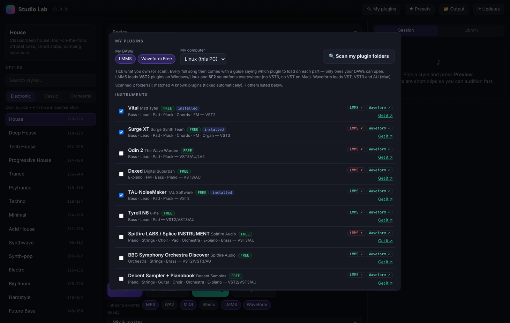
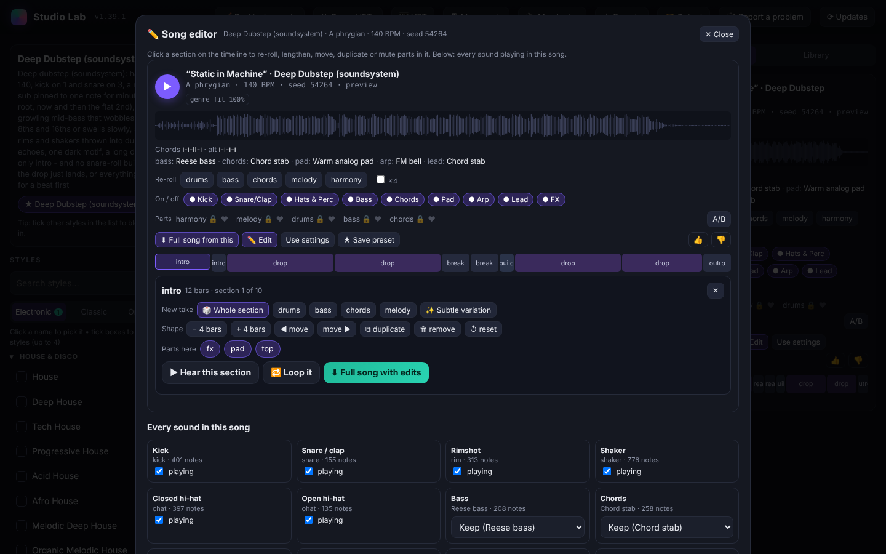

<p align="center">
  
</p>

<h1 align="center">Studio Lab</h1>

<p align="center"><i>A small creative lab for sound ideas.</i></p>

---

<p align="center">
  
</p>

<p align="center">
  &nbsp;&nbsp;
  
</p>

<p align="center">
  
</p>

## Hear it

Short excerpts made by Studio Lab. Each one is rendered straight from the app, with no editing afterwards, using its
built-in sounds only (no downloaded instruments or plugins):

| Genre | Excerpt |
|---|---|
| Deep Dubstep (soundsystem) | [▶ C minor, 142 BPM](docs/samples/deep_dubstep.mp3) |
| Liquid DnB | [▶ C dorian, 173 BPM](docs/samples/liquid_dnb.mp3) |
| Future garage | [▶ Eb dorian, 128 BPM](docs/samples/future_garage.mp3) |
| Nu-disco / disco lounge | [▶ Bb minor, 120 BPM](docs/samples/nu_disco.mp3) |
| Mallet melodic house | [▶ A dorian, 119 BPM](docs/samples/mallet_house.mp3) |
| Hard trap (brass & strings) | [▶ D minor, 152 BPM](docs/samples/hard_trap.mp3) |
| 80s sophisti-pop / jazz-funk pop | [▶ Eb dorian, 100 BPM](docs/samples/sophisti_pop.mp3) |
| Solo Piano Miniature | [▶ G major, 83 BPM](docs/samples/piano_miniature.mp3) |

## Getting started

You need **Python 3.9 or newer** ([python.org](https://www.python.org/downloads/); on Windows tick *Add python.exe to PATH* while installing). The start files check this and tell you if your Python is missing or too old. Then download this repository (green **Code** button → **Download ZIP**) and unzip it, or clone it.

| | |
|---|---|
| **Windows** | Double-click `Start Studio Lab (Windows).bat` |
| **macOS** | Double-click `Start Studio Lab (Mac).command` (first time: right-click → Open) |
| **Linux** | `pip install -r requirements.txt && python3 studiolab.py` |

The app opens in your browser. Everything runs locally on your machine.

*Optional:* install [ffmpeg](https://ffmpeg.org/download.html) for MP3 export. Without it, songs are saved as WAV (everything else works the same).

## Genres

257 genres in three tabs - Electronic, Classic and Orchestral, each sorted into sub-groups (House & Disco, Drum & Bass & Breaks, Jazz, Swing & Big Band, Solo Piano ...) - from house, techno, trance, dubstep, drum & bass, funky breaks, hard dance and hopecore to hip hop, UK road rap, R&B, rock, 90s alt rock, metal, punk, jazz, big band, smooth jazz, country, bluegrass, reggae, salsa, soca, Afrobeats and raga, and from Baroque, Classical and Romantic forms (theme & variations, sonata, minuet & trio) to solo piano miniatures, film scores and the **Cinematic Journey** orchestral generator. Each genre has its own instruments, drum patterns, grooves, song forms and mix. Many are modelled bar by bar on reference records: where the kick, sub, hats and keys come in and drop out, how long each section runs, and how the builds work (often by taking things away, not by speeding up snare rolls). **Build-ups** (ramps into choruses and drops) can be on, subtle (natural band-style fills, no EDM risers) or off, with 23 build-up styles to pick from; **Transition FX** (risers, reverse cymbals, impacts, tape stops) can be varied, fewer, drum fills only or off. **Character** gives every genre twelve high-level traits: arrangement, density, human feel, melodic behaviour, bass personality, drop style, variation, context, texture, rhythmic feel, harmony and energy curve. Change any of them (or tick 🎲 Surprise me) to get a different kind of song in the same genre, e.g. a sparse slow-build house track or a switch-up-heavy one. The full list, with what each one does, is in [docs/GENRES.md](docs/GENRES.md). Every genre's complete technical rules, traits included, are in [docs/GENRE_SPEC.md](docs/GENRE_SPEC.md) for review.

## Daisy Bell

Press **🤖 Daisy Bell** for "Daisy Bell (A Bicycle Built for Two)" (1892, public domain) sung by a creepy early-computer voice over a music-box waltz - it winds down at the end like a machine losing power. From the command line: `python studiolab.py daisy`.

## Song editor

Every result has an **✏️ Edit** button that opens the song in the editor. Click a section on the timeline to re-roll
one part, lengthen or shorten it, move it, duplicate or remove it, or mute parts in it. Below the timeline is
**every sound playing in the song**: the main parts, extra parts, layers, the sounds that take over in other sections,
and the build-up drums. Change any of them or switch it off, then preview it or render the full song. The notes stay
exactly the same.

**Open a past project:** drag any file from an earlier song onto the window, such as its MP3, WAV, MIDI or
`_settings.json`. If the song is still in your output folder, it opens in the editor straight away. If not, it is
rebuilt from its settings.

## Sounds & instruments

Everything that makes sound lives in one window: click **🎚 Sounds & instruments** (top right). It opens on an overview of what you have, with a tab for each: **🎻 Real instruments**, **🎻 Orchestra plugin**, **🎹 VST instruments**, **🎚 Genre VSTs**, **🎛 My samples** and **🔌 Plugins & DAWs**.

Sounds you pick for a part in **Parts** stay picked when you change genre, blend or press Surprise me; parts you leave on default follow the genre. Prefer every genre to choose all its own sounds? Set **When you change genre → Genre picks** at the top of Parts.

### Real instruments

The **🎻 Real instruments** tab downloads free recorded instruments (all public domain / CC0, checked by checksum): an orchestra (strings, brass, woodwinds, harp, mallets), a Steinway grand and an upright, guitars, an electric and an upright bass, percussion, and six real drum kits - a studio kit, a 70s soul kit, a brushed jazz kit, a big rock kit, a modern studio kit and a dirty one - plus a collection of real snares (crisp DnB piccolo, dead 70s, huge 80s). Each genre picks the parts and the kit that suit it; anything not downloaded is played by the built-in synths.

### Drums: style, drummer, percussion and sounds - four separate choices

| Choice | What it changes |
|---|---|
| **Drum style** | What the drums play: the genre's own beat, a classic break (Amen, Think, Funky Drummer ...), the genre's programmed beat without its break, or any other genre's beat. Beats that fit your tempo are listed first, then half / double time, then the rest by feel (four-on-the-floor, half-time, two-step, breakbeat, shuffle, backbeat ...). |
| **Drummer** | How it's played: fills (none / fewer / more), ghost notes (off / more) and hi-hats (sparse 8ths / busy 16ths). |
| **Percussion** | What rides on top of the kit: the genre's own, none, or a set - shakers, tambourine, disco, Latin, Afro, Caribbean, woodblocks. |
| **Drum sounds** | The kit: drum machines (808, 909, CR-78, 606, 707, DMX, LinnDrum ...), real kits, sampled-break kits, drum & bass kits, or your own samples. |

Changing the drum sounds never changes the pattern: jungle on a 909 still plays its Amen break.

## Privacy

Everything runs on your own computer. The app opens a page only your own browser can reach (127.0.0.1), protected by a secret that changes every launch. Nothing is uploaded anywhere. The only internet use is the optional update check and downloads you start yourself (instruments, sound library).

## Updating

Click **⟳ Updates** in the top-right corner. Your files, presets and settings are kept.
(If you cloned with git, `git pull` works too.)

## Genre VSTs

Studio Lab finds the plugins installed on your computer and uses them automatically. The **🎚 Genre VSTs** tab downloads free, open-source plugins - **Surge XT**, **Dexed**, **JC303** and **RipplerX** (modelled mallets, bells and harp) instruments, plus **Dragonfly Reverb** (halls, rooms, plates) and **Airwindows Consolidated** (mixing effects) - and play each genre through the plugin that defines its sound: a 303 for acid, supersaws for trance, a DX7 electric piano for city pop. Plugins you already own, like TAL-NoiseMaker, are used too; save sounds from any plugin with names like "Serum supersaw" or "BBC strings" and matching parts use them.

**Orchestra plugins** (BBC Symphony Orchestra, LABS, Kontakt ...) keep their instruments in their own browser and don't list them to other programs, so Studio Lab detects them instead: **🎚 Sounds & instruments → 🎻 Orchestra plugin → ✨ Detect my instruments** opens the plugin once; click through the instruments (and articulations) you want in its own browser, then close it. Each one is recognised and saved with the right name - e.g. "BBC violins spiccato (Violins 1 · Spiccato)", "BBC celli pizzicato (Celli · Pizzicato)" - and every part that plays strings, celli, horns or woodwinds uses the right one, in any genre. Anything the plugin doesn't name is kept for you to name, and you can still set up one section at a time by hand. Try the orchestral genres: Neoclassical, Chamber, Baroque, Fantasy RPG, Hybrid Trailer, Cinematic, Waltz, Orchestral Hip Hop, Symphonic Metal. Long notes then swell with the mod wheel (CC1), just as a player would ride it.

```
python studiolab.py vsts --for trance      # download what trance needs, show which plugin plays each part
python studiolab.py generate --style trance
python studiolab.py generate --style house --melody blues --voicing drop2 --level lead=-3
```

Each part's **Sound** menu lists your installed plugins too, so you can put any instrument on any part.

## Tips

- Press **▶ Preview** again for a new song; tick 🔒 next to the seed to keep one while you tweak.
- Click a section on a result's timeline to edit it: **▶ Hear this section** plays it with a short lead-in, **🔁 Loop it** repeats up to 8 bars of it seamlessly while you try new takes or sounds.
- On a result, 🔒 keeps a part (drums, bass, chords, melody) for your next previews, ♥ teaches *Surprise me* what you like, and **A/B** compares two results.
- **🎯 Match a reference** takes audio, MIDI, MusicXML or a Studio Lab settings file.
- Export a **DAW pack** for Ableton Live, FL Studio, Logic, Reaper and others.

```
python studiolab.py generate --style rock --reference song.mid --groove laidback --ending hit --formats wav,daw
```

## Works with

- [LMMS](https://lmms.io) (free)
- [Waveform Free](https://www.tracktion.com/products/waveform-free) (free)
- Any DAW that reads MIDI or WAV

## Command line

```
python studiolab.py generate --help
```

## Development

```
pip install -r requirements.txt
python -m tests.features      # genre features (riffs, tuned kicks, classical forms, effects) - about a minute
python -m tests.smoke         # every genre renders (python -m tests.smoke --shard 1/3 for a third of them)
python -m tests.genres        # genre authenticity checks
```

Every genre is defined in one place: its `style(...)` call in `sgcore/styles.py` (patterns, instruments, mix, and its `pools=` of alternative sounds). Composition lives in `sgcore/compose.py`, with music theory in `theory.py`, idiomatic figures (riffs, montunos, variations) in `figures.py`, build-ups and endings in `arrange.py` and previews / loops in `windows.py`; sound is in `instruments.py`, `render.py` and `dsp.py`.

## License

MIT

## Support

If you enjoy Studio Lab, you can support its development through [GitHub Sponsors](https://github.com/sponsors/kefirman9000).
