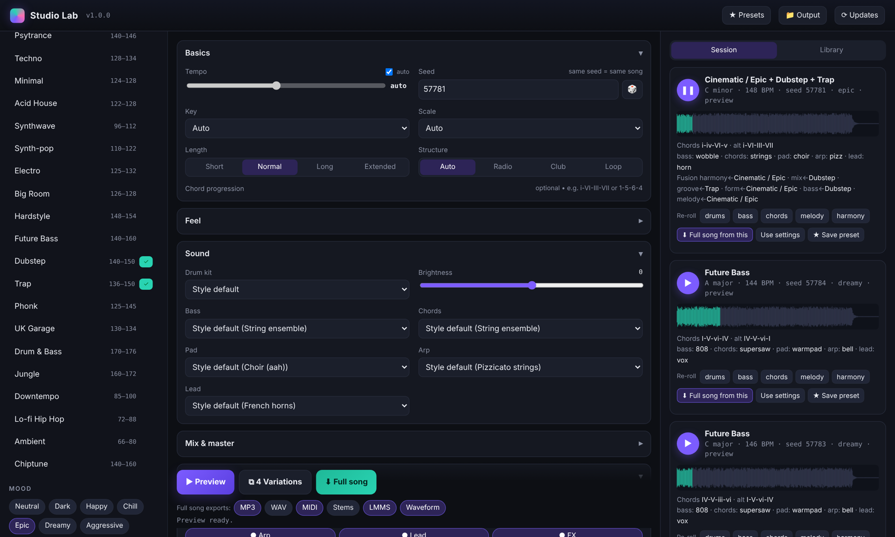
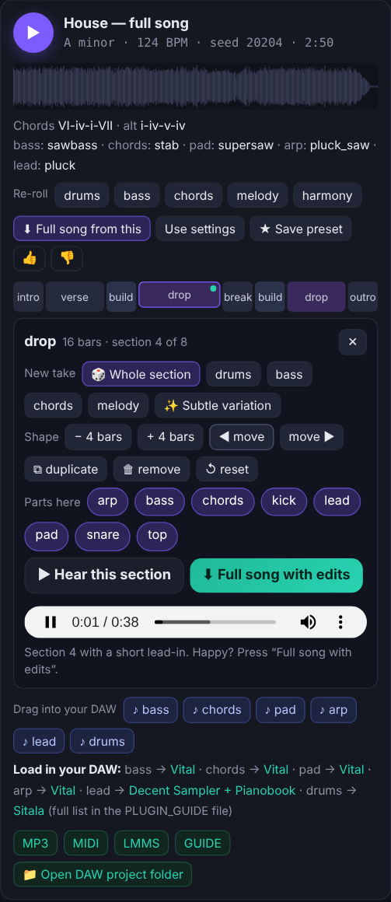

<p align="center">
  
</p>

<h1 align="center">Studio Lab</h1>

<p align="center"><i>A small creative lab for sound ideas.</i></p>

---

<p align="center">
  
</p>

<p align="center">
  &nbsp;&nbsp;
  
</p>

## Getting started

You need **Python 3.9+** ([python.org](https://www.python.org/downloads/)). Then download this repository (green **Code** button → **Download ZIP**) and unzip it, or clone it.

| | |
|---|---|
| **Windows** | Double-click `Start Studio Lab (Windows).bat` |
| **macOS** | Double-click `Start Studio Lab (Mac).command` (first time: right-click → Open) |
| **Linux** | `pip install -r requirements.txt && python3 studiolab.py` |

The app opens in your browser. Everything runs locally on your machine.

*Optional:* install [ffmpeg](https://ffmpeg.org/download.html) for MP3 export.

## Privacy

Everything runs on your own computer. The app opens a page only your own browser can reach (127.0.0.1), protected by a secret that changes every launch. Nothing is uploaded anywhere. The only internet use is the optional update check and downloads you start yourself (instruments, sound library).

## Updating

Click **⟳ Updates** in the top-right corner. Your files, presets and settings are kept.
(If you cloned with git, `git pull` works too.)

## Genre VSTs

Studio Lab finds the plugins installed on your computer and uses them automatically. Click **🎚 Genre VSTs** to download free, open-source instruments (Surge XT, Dexed, JC303) and play each genre through the plugin that defines its sound: a 303 for acid, supersaws for trance, a DX7 electric piano for city pop. Plugins you already own, like TAL-NoiseMaker, are used too; save sounds from any plugin with names like "Serum supersaw" or "BBC strings" and matching parts use them.

```
python studiolab.py vsts --for trance      # download what trance needs, show which plugin plays each part
python studiolab.py generate --style trance
```

## Works with

- [LMMS](https://lmms.io) (free)
- [Waveform Free](https://www.tracktion.com/products/waveform-free) (free)
- Any DAW that reads MIDI or WAV

## Command line

```
python studiolab.py generate --help
```

## License

MIT
